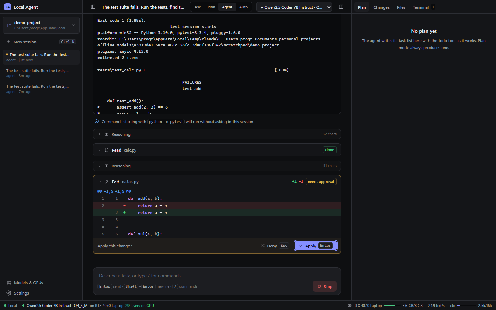
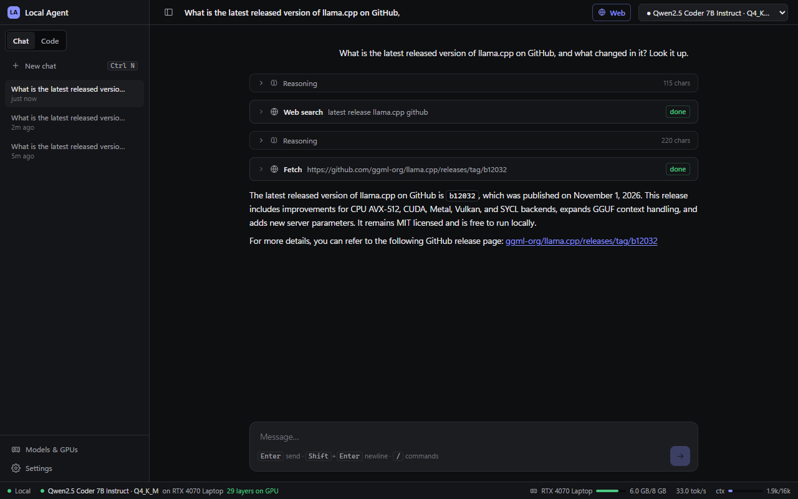

# Local Agent — an offline coding agent on your own GPUs

A local-first desktop app that turns GGUF models on this PC into a **coding agent** in the
style of Claude Code / Codex: it opens a project folder, reads and edits code, runs
PowerShell commands and tests, and asks before anything risky — with **no cloud, no API
keys, no telemetry** by default (paid API models are an opt-in). Models run on the RTX 4070, the RX 9060 XT eGPU, both at once, or the
CPU, and the app **proves** where each model actually runs.



> Current status, measurements and known gaps: **[docs/REPORT.md](docs/REPORT.md)**.
> Design decisions with the evidence behind them: **[docs/DECISIONS.md](docs/DECISIONS.md)**.
> For the next engineer/agent: **[docs/AGENT_HANDOFF.md](docs/AGENT_HANDOFF.md)**.

---

## Quick start

```powershell
# one-time: llama.cpp runtimes (Vulkan sees every GPU; -WithCuda adds the faster RTX 4070 build)
powershell -ExecutionPolicy Bypass -File .\scripts\install-llama-runtimes.ps1 -WithCuda

# desktop app (Electron); builds the UI if needed and starts the backend
powershell -ExecutionPolicy Bypass -File .\scripts\start.ps1

# or in a normal browser: backend + UI at http://127.0.0.1:8765
powershell -ExecutionPolicy Bypass -File .\scripts\dev-backend.ps1
```

(Unsigned scripts are blocked on this machine, hence `-ExecutionPolicy Bypass -File`.)

First run:
1. **Models & GPUs** → scan the `models` folder (or any folder with `.gguf` files).
2. Pick **Run on** for a model (Auto / Single GPU / Multi-GPU / CPU) and **Load**. The card
   then shows e.g. *“29/29 layers on NVIDIA GeForce RTX 4070 Laptop GPU”* with weights, KV
   cache and live VRAM per GPU.
3. **Open a folder** (sidebar) → **New session** (Ctrl+N) → describe a task.

For agent work use a tool-capable model. `Qwen2.5-Coder-7B-Instruct-Q4_K_M` (4.7 GB, fits the
RTX 4070 with a 16k context) is in `models\`; the DeepSeek-R1 1.5B distills are weak at tools.

---

## Chat and Code

The sidebar switches between **Chat** and **Code**; each side remembers its own conversations.

- **Chat** — talk about anything, no project folder needed. With **Web** on (header toggle) the
  model looks things up with `web_search` / `web_fetch` when it needs current or specific
  information, shows each lookup as a card, and cites the pages it used. For models that won't
  emit real tool calls (e.g. Qwen2.5-Coder) each lookup decision is grammar-forced
  (search / fetch / answer) and the final answer still streams.
- **Code** — the coding agent below, working inside a folder. It is also told to search online
  when it is missing information (an API, an error message, a version), when Web is on.

Web is off by default — the app is offline-first — so turning it on is your choice.



## Cloud models (optional): ChatGPT, Claude, DeepSeek via API

Local models are the default, but you can also use paid API models in Chat and Code:

1. **Models & GPUs → Cloud models**, then paste an API key for OpenAI, Anthropic or DeepSeek (or
   set an endpoint for any OpenAI-compatible server, such as OpenRouter).
2. Pick a model name (the ↻ button lists the models your key can use) and click **Add**.
3. Choose it in the model menu in Chat or Code. It is labelled e.g. *claude-opus-5-5 · Claude API*.

Notes:
- A ChatGPT Plus or Claude Pro subscription is **not** an API key. Keys come from
  platform.openai.com, console.anthropic.com and platform.deepseek.com, and usage is billed per token.
- Keys are encrypted with Windows DPAPI in `data\secrets.bin` and are never shown again.
- With a cloud model, your messages, the files the agent reads and command output are sent to
  that provider. Local models stay fully offline.
- One-click chips list the latest models (GPT-6 Luna and Sol, GPT-5, Claude Opus, Sonnet and Haiku 5.5, Fable 5.1, DeepSeek); ↻ swaps in the live list for your key.
- Claude runs through the official `anthropic` SDK with adaptive thinking, shown in the
  reasoning panel. Details are in DECISIONS D10.

## The agent

| Mode | What it can do |
|---|---|
| **Ask** | Read-only: reads, searches, inspects git, answers. |
| **Plan** | Read-only investigation, then a numbered plan in the Plan panel. No edits. |
| **Agent** | Edits files and runs commands; **every edit (shown as a diff) and command waits for your approval**. |
| **Auto** (default) | Fully autonomous: edits are applied immediately (keep/revert them later in Changes) and commands run without asking; **only destructive commands ask**. If the model stops with work left (open todo items, "next steps…", a failed last command, or asking you to choose), the agent continues on its own, up to 12 times per message; step budget 150. |

**Tools:** `read_file`, `list_dir`, `glob`, `grep`, `write_file`, `edit_file` (exact string
replace, diff preview, whitespace-tolerant fallback), `run_command` (Windows PowerShell,
live output, timeout, stop), `git_status` / `git_diff` / `git_log` / `git_commit`,
`todo_write` (Plan panel), and opt-in `web_search` / `web_fetch` (Settings → Internet access).

**Safety and control**
- Only your click approves an action; model text never does. Destructive commands
  (`Remove-Item -Recurse`, `rm -rf`, `git push --force`, `git reset --hard`, `format`, `iwr | iex`, …)
  always need approval. Compound commands are never "always allowed".
- Files outside the opened folder cannot be touched (paths are canonicalised; `..`,
  symlinks and junctions can't escape).
- **Changes panel:** every agent edit per turn with its diff; *keep* or *revert* each file, or
  **Undo last turn**. A revert is refused if you edited the file afterwards.
- Every tool call is written to the audit log (`tool_logs`, `agent.*` entries).
- Context management uses the model's real context size: old tool output is shortened, then
  older turns are summarised (`/compact`).

**Slash commands:** `/help`, `/clear`, `/compact`, `/model <name>`, `/mode ask|plan|agent|auto`,
`/init` (writes an `AGENTS.md` for the project), `/undo`.

**Prompts** are versioned files in `backend/app/agents/prompts/` and editable in
**Settings → Prompts** (overrides live in `data\prompts\`, "Restore default" removes them).
The system prompt is assembled per turn from: role and working rules, mode rules, the tool
catalogue, environment (OS, shell, workspace, date, git branch/status, top-level tree) and the
project's own `AGENTS.md` / `CLAUDE.md`. `variants.json` picks the tool-call format per model:
native OpenAI tools via `llama-server --jinja`, a `<tool_call>` text protocol, or
JSON-schema-constrained steps (used for Qwen2.5-Coder, see DECISIONS D5).

**Keyboard:** Ctrl+K command palette · Ctrl+N new session · Ctrl+1–4 modes · Ctrl+J side
panel · Ctrl+B sidebar · Enter / Esc approve / deny the pending action · Esc stops a run.

---

## GPUs

Each loaded model is its own `llama-server` process (crash-contained; killed with the backend
via a Windows Job Object). Per model you choose:

- **Auto** — the best free *discrete* GPU that holds the model; split across GPUs if none does.
- **Single GPU** — all layers (`-ngl all`) on the card you pick. A saved `n_gpu_layers` of
  0/-1 never means CPU; a positive number is a cap and is reported as a partial offload.
- **Multi-GPU** — one model with layers on several cards at once, using the Vulkan build
  (`--split-mode layer --tensor-split`), default ratio proportional to VRAM, adjustable.
  If only one GPU is present (eGPU unplugged) it loads on that GPU alone, with a notice.
- **CPU**.

The Intel iGPU is never used unless you pick it explicitly. Placement is proven from
llama.cpp's own log (`-lv 4`: “offloaded N/N layers”, buffer sizes per device) and live
per-process VRAM from the Windows GPU counters (vendor-neutral; on WDDM `nvidia-smi` cannot
report per-process memory). Fewer layers on the GPU than requested is shown as a warning.

Why Task Manager may show the Intel GPU busy: it drives the display, so the desktop and the
app's window use it; CUDA work appears under the 4070's "3D"/"Cuda" engine. See DECISIONS D1.

---

## Architecture

```
Electron shell / browser ── React + TS + Vite + Tailwind UI (offline, no CDN)
        │ HTTP + SSE on 127.0.0.1 only
FastAPI backend (Python 3.10)
  ├─ agents/coding/   agent loop, tools, prompts, sessions, checkpoints  (SQLite)
  ├─ models/          registry, placement (devices.py), offload proof (offload.py),
  │                   GPU telemetry (gpu_telemetry.py), llama-server adapter
  ├─ security/        workspace boundary, permissions, audit
  └─ tools/           older tool framework (documents, web, terminal, …)
llama-server.exe per model  (runtimes\llama.cpp\cuda | vulkan, build b11960)
```

Data lives in `data\` (SQLite `local_ai.db`, logs, prompt overrides); it is never committed.

---

## Development

```powershell
cd backend;  python -m pytest                    # ~280 tests, ~1 min; never touches data\
cd desktop\frontend;  npx tsc --noEmit;  npm run build
cd desktop\frontend;  node scripts\screenshots.mjs http://127.0.0.1:8765   # Playwright screenshots (installed Edge)
python scripts\verify_gpu.py --model models\DeepSeek-R1-Distill-Qwen-1.5B-f16.gguf --mode single   # real-GPU placement check
python scripts\agent_e2e.py --workspace <empty folder>   # real-model agent run through the HTTP API
python scripts\ui_test_backend.py --data <scratch folder>   # backend with a throwaway data folder
```

Tests use `tests/fake_llama_server.py` (a stdlib stand-in that prints llama.cpp's real log
format) and a scripted model adapter, so no GPU is needed.

## Troubleshooting

| Symptom | What to do |
|---|---|
| “Only N/M layers fit …” warning | Lower the context, use a smaller quant, or Multi-GPU. |
| eGPU missing | Check Device Manager, then Models & GPUs → Rescan GPUs. Multi-GPU falls back to the 4070 meanwhile. |
| Red dot / “GPU stopped responding” | eGPU unplugged or driver reset. Reconnect, Rescan, Reload. |
| The agent describes code instead of editing | Expected with small models; the agent switches to constrained tool calls automatically. Use Agent/Auto mode. |
| “The model kept repeating the same action” | Rephrase, `/compact`, or use a bigger model. |
| Offline dot in the status bar | Start the backend (`scripts\dev-backend.ps1`) or relaunch the app. |
